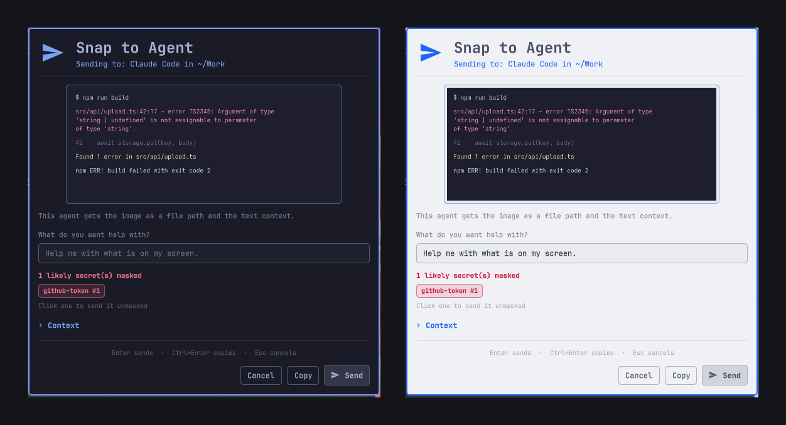
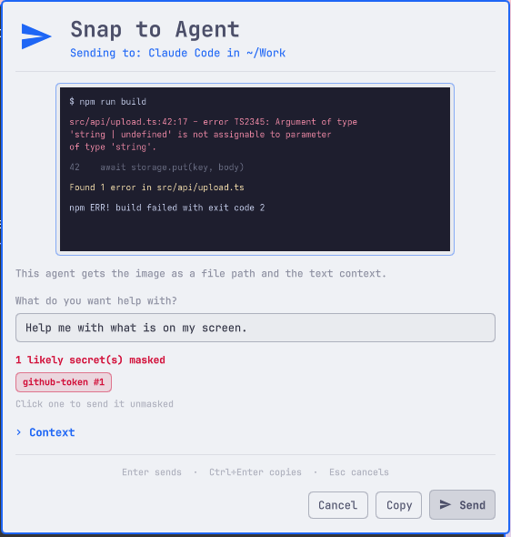

<div align="center">

# Omarchy Snap to Agent

**Send what is on your screen to your default AI agent, with the context it needs to help right away.**

Select a region or a window, check the preview, press Enter. Your agent opens in the right folder with the screenshot, the app and window title and, when you capture a terminal, its folder and git branch already attached. No copying, no pasting, no explaining.



</div>

## Why you will want it

- **It uses the agent you already chose.** It reads Omarchy's default agent every time you send, so changing it in Setup takes effect at once. Claude Code, Codex, Grok, OpenCode and all the others Omarchy lists have an adapter; anything new falls back gracefully.
- **It asks before it acts.** The agent starts in its normal ask-first mode. Omarchy's own launcher adds auto-approve flags to most agents; this plugin never does.
- **You see everything before it leaves.** The preview shows who gets it and in which folder. Likely secrets (API keys, tokens, passwords, private keys) are masked first, and you can undo each mask with one click.
- **It looks like Omarchy.** Colours, fonts, corners and spacing come from your theme, and switching theme updates the panel live.

## In your theme

| Tokyo Night | Catppuccin Latte | Ristretto |
|---|---|---|
|  |  |  |

## Install

```bash
omarchy plugin add https://github.com/PeterVinter/omarchy-snap-to-agent.git --yes
omarchy plugin enable io.github.petervinter.snap-to-agent --section right
```

Then bind a key (see [Suggested keybindings](#suggested-keybindings)) and it is one keystroke from anywhere. Requires Omarchy 4.x; everything else it needs ships with Omarchy. No sudo.

> **Status: v0.1.** Region and window capture. Last terminal error, notifications, clipboard, OCR, history and settings are planned, see [ROADMAP.md](ROADMAP.md).

## What it does

1. You capture a region or the active window.
2. A panel shows a thumbnail, **who gets it and where** ("Sending to: Claude Code in ~/Work"), a question field with a sensible default, and the context block, which you can edit.
3. Likely secrets are masked before you see the text. Click a mask to send that one unmasked.
4. **Send** (Enter) starts your default agent in its own terminal window, in the right directory, with the prompt. **Copy** (Ctrl+Enter) only copies the text. Nothing is sent until you confirm.

Context attached automatically: app class and window title, workspace and monitor, working directory and git branch (for terminals), recent log lines of the window's process, Omarchy version and time. The screenshot is stored in `~/.cache/snap-to-agent/`, scaled to at most 1920 px on the long side and under 2 MB.

## Agent safety

Agents are always started in their normal, **ask-before-acting** mode. Omarchy's own `omarchy-agent` adds auto-approve flags to most agents; this plugin deliberately does not. A test fails if any adapter ever emits one.

## Install

```bash
omarchy plugin add https://github.com/PeterVinter/omarchy-snap-to-agent.git --yes
omarchy plugin enable io.github.petervinter.snap-to-agent --section right
```

Requires Omarchy 4.x, Python 3, `grim`, `slurp`, `wl-clipboard` and ImageMagick (`magick`), which Omarchy ships. No sudo.

## Remove

```bash
omarchy plugin remove io.github.petervinter.snap-to-agent
rm -rf ~/.cache/snap-to-agent
```

The plugin writes nothing else: captures and `last.json` in `~/.cache/snap-to-agent/`. It makes no network calls of its own; only the agent you choose does.

## Use

Click the bar icon for the capture menu, or call the commands below from a keybinding.

| Command | What it does |
|---|---|
| `omarchy-shell io.github.petervinter.snap-to-agent capture region` | Select a region with the mouse |
| `omarchy-shell io.github.petervinter.snap-to-agent capture window` | Capture the active window |
| `omarchy-shell io.github.petervinter.snap-to-agent captureRegion "x,y WxH"` | A fixed area, for scripts |
| `omarchy-shell io.github.petervinter.snap-to-agent resend` | Open the last capture again |
| `omarchy-shell io.github.petervinter.snap-to-agent toggle` | Open or close the panel |
| `omarchy-shell io.github.petervinter.snap-to-agent state` | Current state as JSON |

Keys in the panel: **Enter** sends, **Ctrl+Enter** copies, **Esc** cancels, **Tab** moves to the context section (Enter opens it).

### Suggested keybindings

Add to `~/.config/hypr/bindings.lua`. `SUPER + ALT + S` is taken by Omarchy ("Move window to scratchpad"), so region uses `A` for agent. W, E, N and C are free in a default Omarchy 4.5.

```lua
o.bind("SUPER + ALT + A", "Snap to agent (region)", "omarchy-shell io.github.petervinter.snap-to-agent capture region")
o.bind("SUPER + ALT + W", "Snap to agent (window)", "omarchy-shell io.github.petervinter.snap-to-agent capture window")
```

## Supported agents

All 24 agents that `omarchy-default-agent` lists in Omarchy 4.5 have an adapter. An agent not in this table, for example one added in a newer Omarchy, gets the **generic fallback**: it starts the way Omarchy starts it, the prompt goes to the clipboard, and a toast tells you to paste.

Images: no agent has a tested image flag yet, so every agent gets the screenshot as a **file path** in the prompt (and, from v0.2, the OCR text). The preview says so. A flag will be added per agent only after it has been tested.

| Agent | Name | How the prompt reaches it | Image |
|---|---|---|---|
| Amp | `amp` | Prompt typed in as first message | Path in prompt |
| Antigravity | `agy` | Prompt on the command line | Path in prompt |
| Claude Code | `claude` | Prompt on the command line | Path in prompt |
| Codex | `codex` | Prompt on the command line | Path in prompt |
| Command Code | `commandcode` | Prompt on the command line | Path in prompt |
| Crush | `crush` | Starts empty, prompt on the clipboard | Path in prompt |
| Cursor CLI | `cursor-agent` | Prompt on the command line | Path in prompt |
| DeepSeek Harness | `dsh` | Starts empty, prompt on the clipboard | Path in prompt |
| Devin CLI | `devin` | Prompt on the command line | Path in prompt |
| Freebuff | `freebuff` | Starts empty, prompt on the clipboard | Path in prompt |
| GitHub Copilot | `copilot` | Prompt on the command line | Path in prompt |
| Grok | `grok` | Prompt on the command line | Path in prompt |
| Hermes | `hermes` | Prompt on the command line | Path in prompt |
| Kilo | `kilo` | Prompt on the command line | Path in prompt |
| Kimi | `kimi` | Starts empty, prompt on the clipboard | Path in prompt |
| Kiro CLI | `kiro-cli` | Prompt on the command line | Path in prompt |
| MiniMax Code | `mcode` | Prompt on the command line | Path in prompt |
| Muse Code | `muse` | Prompt on the command line | Path in prompt |
| Oh My Pi | `omp` | Prompt on the command line | Path in prompt |
| OpenClaw | `openclaw` | Prompt on the command line | Path in prompt |
| OpenCode | `opencode` | Prompt on the command line | Path in prompt |
| Ori | `ori` | Prompt on the command line | Path in prompt |
| Pi | `pi` | Prompt on the command line | Path in prompt |
| Qwen Code | `qwen` | Prompt on the command line | Path in prompt |

## Where the agent starts

In the terminal's directory when the capture comes from a terminal. Otherwise in `~/Work` if it exists, else `~`: agents do not remember folder trust for `$HOME` and would ask on every start (the same rule as `omarchy-agent`).

## Privacy

- Nothing is sent without the preview and your confirmation.
- Text is masked for private keys, JWTs, AWS, GitHub, Anthropic, OpenAI, Slack, Google and Stripe keys, Bearer tokens, URL passwords and `password=`/`token=`-style assignments. Masking is pattern based and not a guarantee: read the preview.
- The originals of masked values never leave the helper process and are never written to disk.
- If the prompt is long, the context goes to a file in the cache and the agent is told to read it.

## Development

```bash
python3 -I tests/test_mask.py     # also test_agents, test_capture, test_context, test_compose, test_launch
/usr/lib/qt6/bin/qmllint -I /usr/share/omarchy/shell Panel.qml
```

All capture, context, masking and agent logic is in `helper/` (standard library only) and can be run without the shell. `Panel.qml` only draws.

MIT licensed.
