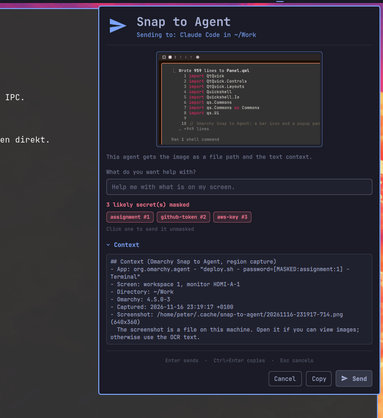
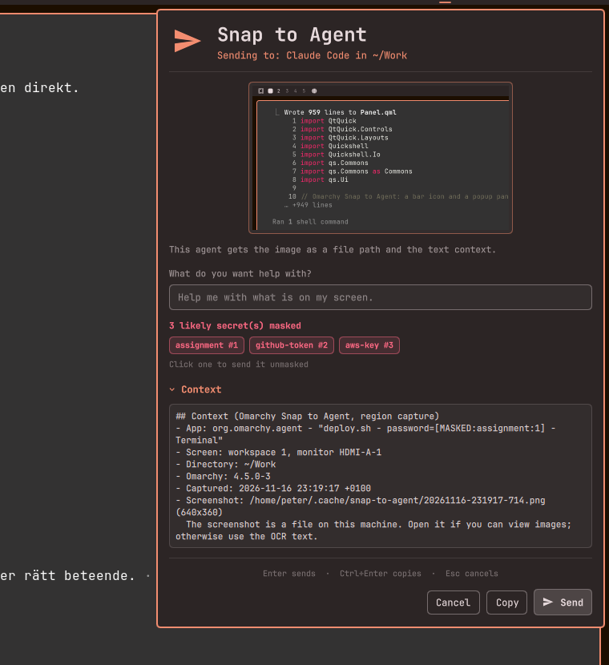
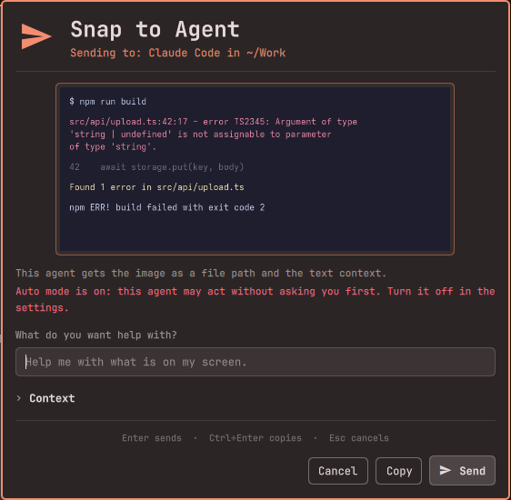
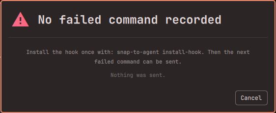
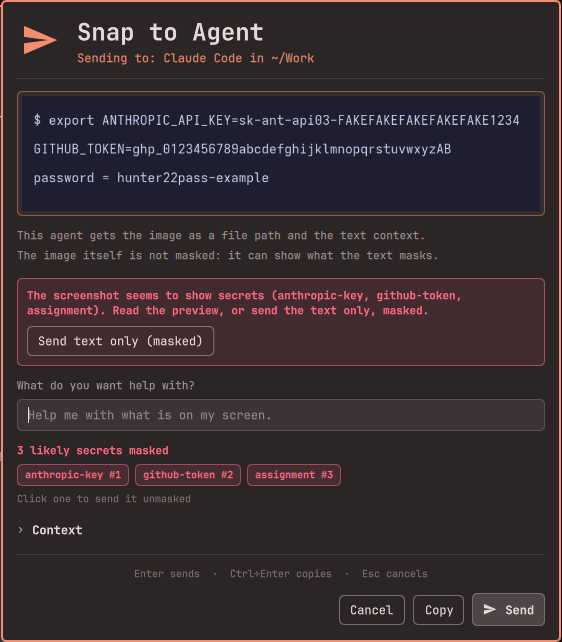
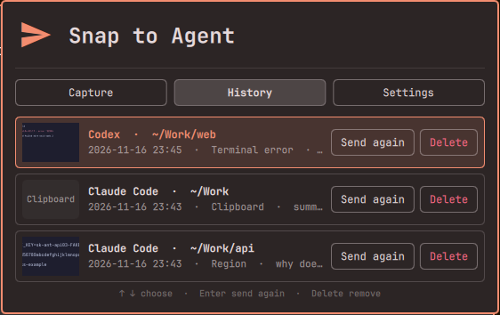
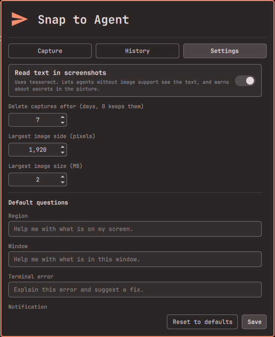
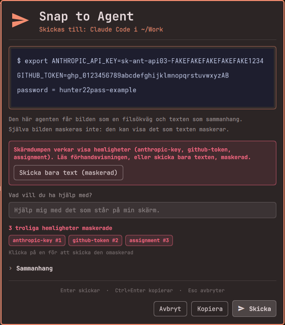

<div align="center">

# Omarchy Snap to Agent

**Send what is on your screen to your default AI agent, with the context it needs to help right away.**

Capture a region, a window, your last terminal error, a notification or the clipboard, check the preview, press Enter. Your agent opens in the right folder with the screenshot or text, the app and window title and, for a terminal, its folder and git branch already attached. No copying, no explaining, and one paste (or none, if you let the agent take the prompt as an argument).


</div>

## Why you will want it

- **It uses the agent you already chose.** It reads Omarchy's default agent every time you send, so changing it in Setup takes effect at once. Claude Code, Codex, Grok, OpenCode and all the others Omarchy lists have an adapter; anything new falls back gracefully.
- **It asks before it acts.** The plugin never adds an auto-approve flag, and it asks Claude Code explicitly for its manual (ask-first) mode. Omarchy's own launcher adds auto-approve flags to most agents; this plugin does not.
- **You see everything before it leaves.** The preview shows who gets it and in which folder. Likely secrets (API keys, tokens, passwords, private keys) are masked first, and you can undo each mask with one click. If a screenshot itself seems to show secrets, you are warned and can send the masked text only.
- **Some windows are never captured.** Password managers, banking and private browser windows are on a blocklist you can edit.
- **It looks like Omarchy.** Colours, fonts, corners and spacing come from your theme, and switching theme updates the panel live.

## In your theme

| Tokyo Night | Catppuccin Latte | Ristretto |
|---|---|---|
|  |  |  |

## Install

```bash
omarchy plugin add https://github.com/PeterVinter/omarchy-snap-to-agent.git --yes
omarchy plugin enable io.github.petervinter.snap-to-agent --section right
```

Then bind a key (see [Suggested keybindings](#suggested-keybindings)) and it is one keystroke from anywhere. Requires Omarchy 4.x; everything else it needs ships with Omarchy. No sudo.

> **Status: v0.4.** Five capture modes, history, a settings view, OCR, a blocklist and the optional shell hook. English and Swedish are shipped; more languages are one file each. See [ROADMAP.md](ROADMAP.md).

## What it does

1. You capture a region or the active window.
2. A panel shows a thumbnail, **who gets it and where** ("Sending to: Claude Code in ~/Work"), a question field with a sensible default, and the context block, which you can edit.
3. Likely secrets are masked before you see the text. Click a mask to send that one unmasked.
4. **Send** (Enter) starts your default agent in its own terminal window, in the right directory, with the prompt. **Copy** (Ctrl+Enter) only copies the text. Nothing is sent until you confirm.

Context attached automatically: app class and window title, workspace and monitor, working directory and git branch (for terminals), recent log lines of the window's process, Omarchy version and time. The screenshot is stored in `~/.cache/snap-to-agent/`, scaled to at most 1920 px on the long side and under 2 MB.

## Agent safety

**By default the agent asks before it acts.** Omarchy's own `omarchy-agent` adds auto-approve flags to most agents; this plugin does not, and a test fails if any adapter emits one in the default mode.

- **Claude Code** is started with `--permission-mode manual`. Without it, a fresh Claude Code 2.1.325 started in "auto mode" here (found with a real send), so the plugin asks for the mode that asks first. The flag applies to that one session only; nothing is written to Claude's settings.
- **Other agents** are started without any permission flag, so they use their own defaults and your own settings for them. The plugin cannot know every agent's default; if one of yours is set to run without asking, that setting still applies. Check it in the agent itself.

### Auto mode (optional)

If you want the agent to act without asking, turn on **Let the agent act without asking (auto mode)** in the settings (`agent_auto` in `config.json`, off by default). The agent is then started the way Omarchy's own launcher starts it, with the agent's auto-approve option where the plugin knows one (for example `--permission-mode auto` for Claude Code, `--approve-for-me` for Codex, `--auto` for OpenCode). Pi, Ori, MiniMax Code, OpenClaw and Freebuff have no such option in Omarchy's launcher, and DeepSeek Harness's is "full access", which is too broad for a checkbox, so those are started as usual. While auto mode is on, the preview says so in red every time.



## Install

```bash
omarchy plugin add https://github.com/PeterVinter/omarchy-snap-to-agent.git --yes
omarchy plugin enable io.github.petervinter.snap-to-agent --section right
```

Requires Omarchy 4.x, Python 3, `grim`, `omasnap` (the region picker; `slurp` is used instead if `omasnap` is missing), `wl-clipboard` and ImageMagick (`magick`), which Omarchy ships. `tesseract` is optional (OCR), `tmux` is optional (terminal output). No sudo.

## Remove

```bash
omarchy plugin remove io.github.petervinter.snap-to-agent
rm -rf ~/.cache/snap-to-agent
```

The plugin writes nothing else: captures, context files, `last.json` and the history in `~/.cache/snap-to-agent/` (mode 600, deleted after the retention period). It makes no network calls of its own; only the agent you choose does.

## Capture modes

| Mode | Command | What the agent gets |
|---|---|---|
| Region | `capture region` | A screenshot of the area you drag (picked with Omarchy's own `omasnap` overlay) |
| Window | `capture window` | A screenshot of the focused window |
| Last terminal error | `capture error` | The failed command, its exit code, directory and output (see below) |
| Notification | `capture notification` | A notification you pick from the latest eight |
| Selection or clipboard | `capture clipboard` | The selected text, else the clipboard text, else a copied image |

Every command is `omarchy-shell io.github.petervinter.snap-to-agent <command>`.

### Last terminal error

A failed command's output cannot be fetched afterwards without getting in the terminal's way, so the plugin uses two cheap parts:

1. **A small shell hook** (optional, installed only if you ask) remembers the last *failed* command, its exit code and its directory. It costs one comparison per prompt, and under 0.3 ms when a command fails; measured in bash and zsh.
2. **The output comes from the terminal.** In tmux it is read with `tmux capture-pane` (capped at 200 lines and 64 KB). Anywhere else (the plugin has no way to read the scrollback of foot or ghostty) it captures the terminal window and reads it with OCR.

```bash
snap-to-agent install-hook      # asks first; adds a marked block to ~/.bashrc (and ~/.zshrc if it exists)
snap-to-agent uninstall-hook    # removes the block and the recorded file
snap-to-agent hook-status
```

`snap-to-agent` is in the plugin folder (`~/.config/omarchy/plugins/io.github.petervinter.snap-to-agent/snap-to-agent`); link it into your `PATH` if you like. The hook records the last failure from any shell that loaded it. Ctrl+C is not counted as an error.



### Secrets in the screenshot

Every image capture is read with `tesseract`. If the text in the picture looks like a key, token or password, the preview warns you and offers **Send text only (masked)**: the image stays on your machine and the agent gets the masked text. Without `tesseract` everything still works, you are just told that no text was read.



### Blocklist and configuration

The plugin refuses to capture a window whose class or title matches the blocklist, including when it is only partly under your region (for window captures, any visible window overlapping the captured rectangle counts, not only the focused one, and visible special-workspace windows count too; if Hyprland cannot say what is visible, or answers in a layout the plugin does not recognise, nothing is captured; both the Hyprland 0.56 and 0.57 layouts are read), and it refuses clipboard and notification captures while such a window has focus. Matching is a case-insensitive substring; a website is only recognised when its name is in the window title. `omasnap` does not tell the plugin which area you picked, so a region capture is refused while any blocked window is visible on screen; with `slurp` only windows under the region count. Set `region_tool` to `auto` (default), `omasnap` or `slurp` in the settings file.

Settings live in `~/.config/snap-to-agent/config.json` (see [config.example.json](config.example.json)): `ocr`, `image` limits, per-mode default `questions`, and the `blocklist` lists. A missing or broken file means the defaults. The settings can also be changed in the panel.

### History

The panel keeps your last 20 sends: a thumbnail, which agent got it, in which folder, when, and your question. **Send again** opens the preview with that capture (it never sends by itself), **Delete** removes the entry and its files. Right-click the bar icon, or run `omarchy-shell io.github.petervinter.snap-to-agent history`.

Only the masked question is kept in the list, even if you undid a mask to send it. The captured state needed to open an entry again is a separate file in `~/.cache/snap-to-agent/`, mode 600, removed with the entry. Every text in it (clipboard, terminal output, notification, OCR and context) is masked before it is written, so **Send again** shows the masked text and a mask can no longer be undone there. The screenshot file is kept as it is (see below).



### Settings

Everything in `config.json` can be changed in the panel (the Settings tab, or `omarchy-shell io.github.petervinter.snap-to-agent settings`): OCR on or off, whether agents may act without asking (off by default), whether the prompt is passed to the agent as an argument (off by default, see Privacy), how long captures are kept (7 days by default, `0` keeps them), image size limits, a default question per mode, the blocklist, and the terminal-error hook, which is only installed after you confirm. **Save** writes the file with mode 600, **Reset to defaults** deletes it.



### Captures are deleted after a week

A context file that holds a value you chose to send unmasked (`*-context-open.md`, only for prompts too large for a command line) is deleted 10 minutes after the agent has started, and in any case 15 minutes after it was written (checked on every helper call), whatever the retention setting. Screenshots, other context files, `last.json` and history entries older than the retention period are removed whenever you capture or open the history. Only files this plugin created in `~/.cache/snap-to-agent/` are ever touched.

### Languages

The panel follows Setup > Language. English and Swedish are included, and a language that is missing a string falls back to English per string. To add one, copy `i18n/en.json` to `i18n/<code>.json` (codes as in Omarchy's language list, for example `da` or `pt-BR`) and translate the values; `tests/test_i18n.py` checks that no key is missing. The text sent to the agent (the context block) stays in English on purpose.



## Use

Click the bar icon for the capture menu, right-click it for the history, or call the commands below from a keybinding.

| Command | What it does |
|---|---|
| `omarchy-shell io.github.petervinter.snap-to-agent capture region` | Select a region with the mouse |
| `omarchy-shell io.github.petervinter.snap-to-agent capture window` | Capture the active window |
| `omarchy-shell io.github.petervinter.snap-to-agent capture error` | Send the last failed terminal command |
| `omarchy-shell io.github.petervinter.snap-to-agent capture notification` | Pick a recent notification |
| `omarchy-shell io.github.petervinter.snap-to-agent capture clipboard` | Send the selection or clipboard |
| `omarchy-shell io.github.petervinter.snap-to-agent captureRegion "x,y WxH"` | A fixed area, for scripts |
| `omarchy-shell io.github.petervinter.snap-to-agent resend` | Open the last capture again |
| `omarchy-shell io.github.petervinter.snap-to-agent history` | Open the history |
| `omarchy-shell io.github.petervinter.snap-to-agent settings` | Open the settings |
| `omarchy-shell io.github.petervinter.snap-to-agent toggle` | Open or close the panel |
| `omarchy-shell io.github.petervinter.snap-to-agent state` | Current state as JSON |

Keys in the panel: **Enter** sends, **Ctrl+Enter** copies, **Esc** cancels, **Tab** moves to the context section (Enter opens it).

### Suggested keybindings

Add to `~/.config/hypr/bindings.lua`. `SUPER + ALT + S` is taken by Omarchy ("Move window to scratchpad"), so region uses `A` for agent. W, E, N and C are free in a default Omarchy 4.5 and in `~/.config/hypr/bindings.lua` of the tested setup.

```lua
o.bind("SUPER + ALT + A", "Snap to agent (region)", "omarchy-shell io.github.petervinter.snap-to-agent capture region")
o.bind("SUPER + ALT + W", "Snap to agent (window)", "omarchy-shell io.github.petervinter.snap-to-agent capture window")
o.bind("SUPER + ALT + E", "Snap to agent (last terminal error)", "omarchy-shell io.github.petervinter.snap-to-agent capture error")
o.bind("SUPER + ALT + N", "Snap to agent (notification)", "omarchy-shell io.github.petervinter.snap-to-agent capture notification")
o.bind("SUPER + ALT + C", "Snap to agent (selection or clipboard)", "omarchy-shell io.github.petervinter.snap-to-agent capture clipboard")
```

## Supported agents

All 24 agents that `omarchy-default-agent` lists in Omarchy 4.5 have an adapter. An agent not in this table, for example one added in a newer Omarchy, gets the **generic fallback**: it starts the way Omarchy starts it, the prompt goes to the clipboard, and a toast tells you to paste.

Images: no agent has a tested image flag yet, so every agent gets the screenshot as a **file path** in the prompt (and, from v0.2, the OCR text). The preview says so. A flag will be added per agent only after it has been tested.

| Agent | Name | How the prompt reaches it (default) | Image |
|---|---|---|---|
| Amp | `amp` | Prompt typed in as first message | Path in prompt |
| Antigravity | `agy` | Clipboard by default; command line if you opt in | Path in prompt |
| Claude Code | `claude` | Clipboard by default; command line if you opt in | Path in prompt |
| Codex | `codex` | Clipboard by default; command line if you opt in | Path in prompt |
| Command Code | `commandcode` | Clipboard by default; command line if you opt in | Path in prompt |
| Crush | `crush` | Starts empty, prompt on the clipboard | Path in prompt |
| Cursor CLI | `cursor-agent` | Clipboard by default; command line if you opt in | Path in prompt |
| DeepSeek Harness | `dsh` | Starts empty, prompt on the clipboard | Path in prompt |
| Devin CLI | `devin` | Clipboard by default; command line if you opt in | Path in prompt |
| Freebuff | `freebuff` | Starts empty, prompt on the clipboard | Path in prompt |
| GitHub Copilot | `copilot` | Clipboard by default; command line if you opt in | Path in prompt |
| Grok | `grok` | Clipboard by default; command line if you opt in | Path in prompt |
| Hermes | `hermes` | Clipboard by default; command line if you opt in | Path in prompt |
| Kilo | `kilo` | Clipboard by default; command line if you opt in | Path in prompt |
| Kimi | `kimi` | Starts empty, prompt on the clipboard | Path in prompt |
| Kiro CLI | `kiro-cli` | Clipboard by default; command line if you opt in | Path in prompt |
| MiniMax Code | `mcode` | Clipboard by default; command line if you opt in | Path in prompt |
| Muse Code | `muse` | Clipboard by default; command line if you opt in | Path in prompt |
| Oh My Pi | `omp` | Clipboard by default; command line if you opt in | Path in prompt |
| OpenClaw | `openclaw` | Clipboard by default; command line if you opt in | Path in prompt |
| OpenCode | `opencode` | Clipboard by default; command line if you opt in | Path in prompt |
| Ori | `ori` | Clipboard by default; command line if you opt in | Path in prompt |
| Pi | `pi` | Clipboard by default; command line if you opt in | Path in prompt |
| Qwen Code | `qwen` | Clipboard by default; command line if you opt in | Path in prompt |

## Where the agent starts

In the terminal's directory when the capture comes from a terminal. Otherwise in `~/Work` if it exists, else `~`: agents do not remember folder trust for `$HOME` and would ask on every start (the same rule as `omarchy-agent`).

## Privacy

- Nothing is sent without the preview and your confirmation.
- Text is masked for private keys, JWTs, AWS, GitHub, Anthropic, OpenAI, Slack, Google and Stripe keys, Bearer tokens, URL passwords and `password=`/`token=`-style assignments. Masking is pattern based and not a guarantee: read the preview.
- The originals of masked values stay in the panel's memory while the preview is open. Every captured text (clipboard, terminal output, notification, OCR, context) is masked before `last.json` and the history are written, so no raw secret from those texts reaches the disk. Files that an older version (before 0.4.1) wrote with raw text are masked in place the first time the plugin touches the cache after an upgrade (on the next capture, or when you open the history or Send again), also when retention is turned off.
- **Screenshots are the exception.** The image file is saved as it is, in `~/.cache/snap-to-agent/` (mode 600), and is deleted after the retention period (7 days by default; set `retention_days` lower, or `0` keeps it). If it shows a secret, the secret is in that file; the preview warns and offers **Send text only (masked)**, but the file stays until it is cleaned up or you delete the history entry.
- **By default the prompt never appears on any command line.** Agents that take their prompt as an argument (most of them) are started empty and the prompt goes to the clipboard with a toast: paste it. Other accounts on the computer can read process arguments (`/proc/<pid>/cmdline`) while a session runs, and the prompt can contain clipboard, terminal and notification text. Amp takes the prompt on stdin through a private file (mode 600 in `$XDG_RUNTIME_DIR`, deleted by `helper/start_agent.py` as soon as it is read), which never touches a command line.
- **Opt-in:** turn on **Pass the prompt to the agent as an argument** in the settings (`prompt_as_argument` in `config.json`, off by default) to start the agent with the prompt already in place. The same private file hands it over to the agent, so the terminal, launcher and wrapper never see it, but the agent's own process has it on its command line for as long as the session lives. The preview warns in red while this is on.
- If the prompt is long, the context goes to a file in the cache and the agent is told to read it.

## Development

```bash
for t in tests/test_*.py; do python3 -I "$t"; done
/usr/lib/qt6/bin/qmllint -I /usr/share/omarchy/shell Panel.qml
```

All capture, context, masking and agent logic is in `helper/` (standard library only) and can be run without the shell. `Panel.qml` only draws.

MIT licensed.
